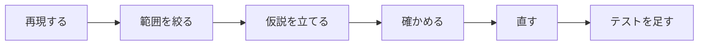

# デバッガで流れを追う

第4回（制御構造）の演習の前に

<div class="opacity-70 mt-8">

Visual Studio のブレークポイント・ステップオーバー・ローカル変数の表示

</div>

<!--
全体の目安: 5〜7 分（表紙と本編 11 枚。付録 3 枚（区切りを含む）は配布用で，発表では飛ばす）。時間が足りなければ「よくあるつまずき」を飛ばす。さらに短くするなら「今日できるようになること」を口頭の 1 文にし，Q2 を省く（約 5 分）。
- 講義の「7　二重ループとテスト」でブレークポイントとステップオーバーを扱った回に使う。全員に見せるのは担当教員の了承を得たときだけ。
- Visual Studio で実演できるなら，③〜⑤は VS の画面で見せ，スライドは要点の確認に使う。
- 画面の表記は Visual Studio 2026（英語版）。日本語版の名前を括弧で添えている。
-->

---

# 今日できるようになること

<v-clicks>

1. 調べたい行で**プログラムを止める**（ブレークポイント）
2. **1 文ずつ**進めて，どの行が実行されたかを見る（ステップオーバー）
3. その時点の**変数の値**を見る（**Locals** ウィンドウ）

</v-clicks>

<div v-click class="mt-10 p-4 border rounded">

紙に書いた「値の追跡表」を，デバッガで**答え合わせ**できるようになる

</div>

<!--
目安 20 秒。
「演習の課題にも値を追跡する表があります。紙で予測してから，デバッガで答え合わせする順番がおすすめです」
-->

---

# 例: 合計と 2 乗の合計

<div class="code-large">

```c {all|6-7|8-11|12|all}
#include <stdio.h>

int main(void)
{
    int n = 3;
    int sum = 0;     // 1 から n までの合計
    int sumsq = 0;   // 1 から n までの 2 乗の合計
    for (int i = 1; i <= n; ++i) {
        sum += i;
        sumsq += i;
    }
    printf("%d %d\n", sum, sumsq);   // n = 3 なら 6 14 のはず
    return 0;
}
```

</div>

<div v-click class="mt-2">

**期待**: `6 14` ／ **実際**（Ctrl+F5）: `6 6` → 2 乗の合計がおかしい

</div>

<!--
目安 40 秒。
演習の課題やデバッグの題材とは違う種類の誤りを使っている（答えを見せないため）。
誤りは 10 行目の sumsq += i;（9 行目をコピーして i * i に直し忘れた）。ここでは答えを言わない。
「コンパイラは警告を出しません。文法は正しいので，動かして調べるしかありません」
-->

---

# 探し方の型



<v-clicks>

- **再現する**: 同じ入力で毎回同じ違いが出る（`n = 3` で `6 6`）
- **範囲を絞る**: 何回目の繰り返しまでは正しいか
- **仮説を立てる**: 「どの文が，何を間違えているか」を 1 文で言う
- **確かめる**: 止めて，変数の値を見る ← **今日はここ**

</v-clicks>

<div v-click class="mt-4 opacity-80">

`printf` を足すより先に，デバッガで止めて見る（書き直し・消し忘れがない）

</div>

<!--
目安 40 秒。
printf とデバッガの比較の表は付録にある（質問されたら見せる）。
-->

---

# ① ブレークポイントを置いて，② F5 で開始

<div class="code-large">

```c {9|all}
#include <stdio.h>

int main(void)
{
    int n = 3;
    int sum = 0;     // 1 から n までの合計
    int sumsq = 0;   // 1 から n までの 2 乗の合計
    for (int i = 1; i <= n; ++i) {
        sum += i;
        sumsq += i;
    }
    printf("%d %d\n", sum, sumsq);   // n = 3 なら 6 14 のはず
    return 0;
}
```

</div>

- 9 行目で **F9**（**Debug > Toggle Breakpoint**／ブレークポイントの設定/解除）→ 赤い丸
- **F5**（**Debug > Start Debugging**／デバッグの開始）で開始。**Ctrl+F5 では止まらない**

<!--
目安 40 秒。
- 止まると，次に実行する行に黄色の矢印が出る。その行はまだ実行されていない。
- 質問「止まらない」→ ほとんどは Ctrl+F5 で起動している。次に多いのは，ビルドに失敗して古い実行ファイルが動いている（Error List を見る）。
-->

---

# ③ Locals で変数を見る

**Debug > Windows > Locals**（ローカル）。F5 をもう一度押すと次に止まるまで進む（**Debug > Continue**／続行。授業では未習）

| 止まった回 | `i` | `sumsq`（実際） | `sumsq`（予測） |
| --- | --- | --- | --- |
| 1 回目 | 1 | 0 | 0 |
| 2 回目 | 2 | 1 | 1 |
| 3 回目 | 3 | <span v-mark.red="1">3</span> | <span v-mark.red="1">5</span> |

<div v-click="2" class="mt-4">

**範囲**: 2 回目までは合っていて，3 回目で違う → **2 回目の繰り返しの中**

</div>

<div v-click="3" class="mt-2">

**仮説**: 2 回目に `sumsq` に足した値が 4 ではない → F10 で 1 文ずつ見て確かめる

</div>

<!--
目安 60 秒。
- 止まった 9 行目の値は「この回で足す前」の値。予測は「その回の前までの 2 乗の合計」（1 回目 0，2 回目 1，3 回目 1 + 4 = 5）。
- Continue は講義では扱っていない（F5 をもう一度押すと次のブレークポイントまで進む，とだけ言えばよい）。
- 質問「Locals が見つからない」→ デバッグ中（止まっている間）に Debug > Windows > Locals で開く。
- ここで 3 回目まで進めたら，次の④の前に Shift+F5 で止め，F5 → F5（2 回目に止まる）からやり直す。
-->

---

# 問い

<div v-click>

**Q1.** 2 回目に止まった所（9 行目）から F10 を 2 回押すと，矢印はどの行？

</div>

<div v-click class="mt-4">

**Q2.** `n = 0` にして F5 で開始すると，9 行目のブレークポイントで止まる？

</div>

<!--
目安 40 秒。答えはすぐに言わず，近くの人と相談させてもよい。Q1 は次の④で確かめる。
- A1. 8 行目（for の行）。本体の最後の文を実行すると，++i と条件判定 i <= n をするために for の行へ戻る。よくある誤答: 9 行目（++i を飛ばして考える）。
- A2. 止まらない。最初の条件判定 1 <= 0 が偽で，本体を 1 回も実行しないから（講義 7 節の 0 回の場合）。
-->

---

# ④ 2 回目から F10 で 1 文ずつ

2 回目に止まったところ（`i` = 2，`sumsq` = 1）から **F10**（**Debug > Step Over**／ステップ オーバー）

<div class="code-large">

```c {9|10|8|9|all}
#include <stdio.h>

int main(void)
{
    int n = 3;
    int sum = 0;     // 1 から n までの合計
    int sumsq = 0;   // 1 から n までの 2 乗の合計
    for (int i = 1; i <= n; ++i) {
        sum += i;
        sumsq += i;
    }
    printf("%d %d\n", sum, sumsq);   // n = 3 なら 6 14 のはず
    return 0;
}
```

</div>

<div v-click="2" class="text-red-600">

10 行目を実行すると `sumsq` が 1 → **3**（**Locals** で赤くなる）。足されたのは 4 ではなく 2 → 10 行目が `i` を足している

</div>

<!--
目安 60 秒。クリックごとの矢印の行と，そのとき Locals に見える値（矢印の行はまだ実行していない）:
矢印 9（i = 2, sum = 1, sumsq = 1）→ 矢印 10（sum = 3。赤）→ 矢印 8（sumsq = 3。赤。ここで本文が出る）→ 矢印 9（i = 3）。
- Q1 の答え（8 行目）をここで確かめる。
- 質問「} の行で止まらないのはなぜ」→ 実行する文がない行だから。
-->

---

# ⑤ 直して，境界の値で確かめる

```diff {*}{lines:false}
-        sumsq += i;
+        sumsq += i * i;
```

<div v-click>

| `n` | 0 | 1 | 2 | 3 |
| --- | --- | --- | --- | --- |
| 本体の回数 | 0 回 | 1 回 | 2 回 | 3 回 |
| 期待する出力 | `0 0` | `1 1` | `3 5` | `6 14` |

</div>

<div v-click class="mt-2 opacity-80">

繰り返しは **0 回・1 回・複数回**で試す（講義 7 節）。`n = 1` では直す前も `1 1` で，誤りに気付けない

</div>

<div v-click class="mt-2">

この表を記録に残す＝**テストを足す**。次に同じところを直したときも，この 4 つで確かめる

</div>

<!--
目安 50 秒。
直す前の版は n = 0, 1 では正しい値（0 0, 1 1）を出し，n = 2 から違う（3 3, 6 6）。1 つの値で合っても正しいとは限らない，という話につなげる。
「コピーして直すときは，直し忘れがないかを見直す」と一言添えてもよい。
-->

---

# よくあるつまずき

<v-clicks>

- **止まらない** → Ctrl+F5 で起動している／その行が実行されない（`n = 0` など）／ビルドに失敗して古い実行ファイルが動いている（**Error List** を見る）
- **変な数が見える**（Debug 構成で `-858993460` など）→ まだ代入される前の変数。値に意味はない
- **止まらなくなった**（無限ループ）→ **Debug > Stop Debugging**（デバッグの停止，Shift+F5）。Ctrl+F5 で起動したならコンソールウィンドウを閉じる（講義 4 節）
- どの行を繰り返しているか見たいとき → **Debug > Break All**（授業では未習）で一時停止

</v-clicks>

<!--
目安 40 秒。
-858993460 はこの例では出てこない（未初期化の変数がないため）。第8回の手引きで Watch 1 の temp として出てくるので，ここでは名前だけ紹介する。
Break All は授業で扱っていない。無限ループの学生がいたら，巡回中に個別に見せる程度でよい。
-->

---
layout: center
---

# まとめ

1. 調べたい行で **F9**，**F5** で開始（Ctrl+F5 では止まらない）
2. **Locals** で変数を見て，予測と違う回を探す
3. その回を **F10** で 1 文ずつ。値が変わった行が誤りの近く

<div class="mt-8 opacity-80 text-sm">

F9 ブレークポイント ／ F5 開始・続行 ／ F10 ステップ オーバー ／ Shift+F5 停止

</div>

<div class="mt-6 p-4 border rounded">

課題の「値を追跡する」表を，デバッガで答え合わせしてみましょう

</div>

<!--
目安 20 秒。
早く終えた学生には，デバッグの題材（debugging/ の第4回の題材）を渡して練習させる。題材の README は答えを含むので，学生にはソースだけを渡す。
-->

---
layout: section
---

# 付録

発表では使わない。質問されたとき・配布用

---

# 付録: printf を足す前に

| | `printf` を足して実行 | デバッガで止める |
| --- | --- | --- |
| 見られるもの | 書いた式の値だけ | その時点で見えている変数をまとめて |
| 見る場所を変えるとき | 書き直してビルドし直す | ブレークポイントを動かすだけ |
| 「どの行を通ったか」 | 分かりにくい | 黄色の矢印で分かる |
| 後始末 | 消し忘れると出力が変わる | 何も残らない |

`printf` が悪いわけではない。「どこで・何が」違うかを探すときは，まずデバッガ。

---

# 付録: キーの早見表

| キー | 英語版 | 日本語版 | 授業で扱う回 |
| --- | --- | --- | --- |
| F9 | **Toggle Breakpoint** | ブレークポイントの設定/解除 | 第4回 講義 |
| F5 | **Start Debugging** ／ **Continue** | デバッグの開始／続行 | 第4回 講義（続行は未習） |
| F10 | **Step Over** | ステップ オーバー | 第4回 講義 |
| Shift+F5 | **Stop Debugging** | デバッグの停止 | 第4回 講義 |
| F11 | **Step Into** | ステップ イン | 第14回 講義（実務の手引きでは第8回で先取り） |
| Shift+F11 | **Step Out** | ステップ アウト | 講義では未習（実務の手引きでは第8回） |

メニューはどれも **Debug** の下。VS Code では **Run and Debug** ビューで同じキーが使える。
