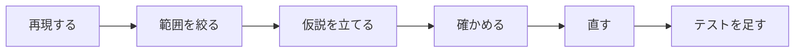

# デバッガで流れを追う

止めて，1 文ずつ進めて，変数の値を見る

<div class="opacity-70 mt-8">

関係する回: 第4回〜（ブレークポイント・ステップオーバー・ローカル変数は第4回 講義 7 節。キーは第14回）

</div>

<!--
使う場面: 実行結果が期待と違うのに，どの行が原因か見当が付かない学生。値の追跡表（第4回の課題2 など）を紙で書いた学生に，答え合わせとして見せる。
- 全部を見せなくてよい。初めての学生には「① 止める」「② Locals で見る」の 2 枚，止め方を知っている学生には「③ F10」から。
- 学生のプログラムで同じ操作をさせるのがいちばんよい。スライドの例は操作の説明用（課題やデバッグの題材とは違う誤りにしてある）。
- 講義（第4回 7 節）に出るのは操作の名前（ブレークポイント・デバッグ実行・ステップオーバー・ローカル変数）だけで，キー（F9・F5・F10）は第14回に出てくる。メニューからでも同じ操作ができる。
- 画面の表記は Visual Studio 2026（英語版）。日本語版の名前を括弧で添えている。
-->

---

# 例: 合計と 2 乗の合計

<div class="code-large">

```c {all|6-7|8-11|12|all}
#include <stdio.h>

int main(void)
{
    int n = 3;
    int sum = 0;     // 1 から n までの合計
    int sumsq = 0;   // 1 から n までの 2 乗の合計
    for (int i = 1; i <= n; ++i) {
        sum += i;
        sumsq += i;
    }
    printf("%d %d\n", sum, sumsq);   // n = 3 なら 6 14 のはず
    return 0;
}
```

</div>

<div v-click class="mt-2">

**期待**: `6 14` ／ **実際**（Ctrl+F5）: `6 6` → 2 乗の合計がおかしい。コンパイラは警告を出さないので，動かして調べる

</div>

<!--
誤りは 10 行目の sumsq += i;（9 行目をコピーして i * i に直し忘れた）。学生には答えを言わず，次のスライドからの手順で見つけさせる。
使う場面: 操作を説明する前に，「期待と実際が違う」状態を共有する 1 枚。学生自身のプログラムで同じ状態があるなら，このスライドは飛ばして学生のコードで進める。
問「期待する 14 はどう計算した？」→ 1 + 4 + 9。期待値を先に書いておくから，違いに気付ける。
反応「どこが違うか見れば分かる」→ 見て分かるならそれでよい。分からないときに使う手順として，次のスライドから見せる。
-->

---

# 探し方の型



- **再現する**: 同じ入力で毎回同じ違いが出る（`n = 3` で `6 6`）
- **範囲を絞る**: 何回目の繰り返しまでは正しいか
- **仮説を立てる**: 「どの文が，何を間違えているか」を 1 文で言う
- **確かめる**: 止めて，変数の値を見る（次のスライドから）
- **直す**: 1 か所だけ直し，同じ手順でもう一度実行する
- **テストを足す**: 誤りに気付ける入力（境界）と期待する出力を表に残す

<!--
使う場面: printf をあちこちに足し始めた学生や，思い付いた所を次々に書き換えている学生。
問「今どの段階？」→ たいていは「再現」と「仮説」を飛ばしている。printf とデバッガの比べ方は付録にある。
-->

---

# ① 止める: ブレークポイントを置いて F5

<div class="text-sm opacity-80 -mt-2 mb-1">キーは第14回の講義で出る。メニュー（<b>Debug</b> の下）からでも同じ</div>

<div>

```c {9|all}
#include <stdio.h>

int main(void)
{
    int n = 3;
    int sum = 0;     // 1 から n までの合計
    int sumsq = 0;   // 1 から n までの 2 乗の合計
    for (int i = 1; i <= n; ++i) {
        sum += i;
        sumsq += i;
    }
    printf("%d %d\n", sum, sumsq);   // n = 3 なら 6 14 のはず
    return 0;
}
```

</div>

- 調べたい行（9 行目。繰り返しの本体の最初の文で，毎回ここを通る）で **F9**（**Debug > Toggle Breakpoint**／ブレークポイントの設定/解除）→ 赤い丸
- **F5**（**Debug > Start Debugging**／デバッグの開始。**Ctrl+F5 では止まらない**）→ 次に実行する行（まだ実行していない）に黄色の矢印

<!--
- キーの代わりにメニュー（Debug の下）からでもよい。
- 反応「止まらない」→ ほとんどは Ctrl+F5 で起動している。次に多いのは，ビルドに失敗して古い実行ファイルが動いている（Error List を見る）。その行が実行されない場合もある（下の問い）。
- 問「n = 0 にして F5 で開始すると，9 行目で止まる？」→ 止まらない。最初の条件判定 1 <= 0 が偽で，本体を 1 回も実行しないから（講義 7 節の 0 回の場合）。
-->

---

# ② Locals で値を見る

**Debug > Windows > Locals**（ローカル）。もう一度 F5（**Debug > Continue**／続行。授業では未習）を押すと，次にブレークポイントに来るまで進む

| 止まった回 | `i` | `sumsq`（実際） | `sumsq`（予測） |
| --- | --- | --- | --- |
| 1 回目 | 1 | 0 | 0 |
| 2 回目 | 2 | 1 | 1 |
| 3 回目 | 3 | <span v-mark.red="1">3</span> | <span v-mark.red="1">5</span> |

<div v-click="2" class="mt-4">

**範囲**: 2 回目までは合っていて，3 回目で違う → 原因は **2 回目の繰り返しの中**

</div>

<div v-click="3" class="mt-2">

**仮説**: 2 回目に `sumsq` を変える 10 行目が，4（`i` の 2 乗）ではない値を足している。正しければ 10 行目の前後で `sumsq` は 1 → 5 になるはず

</div>

<!--
- 止まった 9 行目の値は「この回で足す前」の値。予測は「その回の前までの 2 乗の合計」（1 回目 0，2 回目 1，3 回目 1 + 4 = 5）。学生には予測の列を先に書かせる。
- もう一度押す F5 は Debug > Continue（続行）で，授業では未習。「もう一度 F5 で次のブレークポイントまで進む」とだけ言えばよい。
- 問「3 回目に止まったときの sumsq の予測は？」→ 5（1 回目と 2 回目に足した 1 + 4）。予測を先に言わせてから Locals を見る。
- 反応「Locals が見つからない」→ 止まっている間に Debug > Windows > Locals で開く。
- 3 回目まで進めたら，次の③の前に Shift+F5 で止め，F5 → F5（2 回目に止まる）からやり直す。
-->

---

# ③ F10 で 1 文ずつ進める

F5 で 1 回目に止まったら，もう一度 F5。2 回目に止まったところ（`i` = 2，`sumsq` = 1）から **F10**（**Debug > Step Over**／ステップ オーバー）。②で 3 回目まで進めたなら，Shift+F5（**Debug > Stop Debugging**）で止めてからやり直す

<div>

```c {9|10|8|9|all}
#include <stdio.h>

int main(void)
{
    int n = 3;
    int sum = 0;     // 1 から n までの合計
    int sumsq = 0;   // 1 から n までの 2 乗の合計
    for (int i = 1; i <= n; ++i) {
        sum += i;
        sumsq += i;
    }
    printf("%d %d\n", sum, sumsq);   // n = 3 なら 6 14 のはず
    return 0;
}
```

</div>

<div v-click="2" class="text-red-600">

10 行目で `sumsq` が 1 → **3**（赤）。足したのは 4 ではなく 2 → 10 行目が `i` を足している

</div>

<!--
クリックごとの矢印の行と，そのとき Locals に見える値（矢印の行はまだ実行していない）:
矢印 9（i = 2, sum = 1, sumsq = 1）→ 矢印 10（sum = 3。赤）→ 矢印 8（sumsq = 3。Locals で値が変わった変数は赤くなる。ここで本文が出る）→ 矢印 9（i = 3）。
- 押す前に聞く問「9 行目から F10 を 2 回押すと，矢印はどの行？」→ 8 行目（for の行）。本体の最後の文を実行すると，++i と条件判定 i <= n をするために for の行へ戻る。よくある誤答: 9 行目（++i を飛ばして考える）。
- 反応「} の行で止まらないのはなぜ」→ 実行する文がない行だから。
-->

---

# ④ 直して，境界の値で確かめる

```diff {*}{lines:false}
-        sumsq += i;
+        sumsq += i * i;
```

| `n` | 0 | 1 | 2 | 3 |
| --- | --- | --- | --- | --- |
| 本体の回数 | 0 回 | 1 回 | 2 回 | 3 回 |
| 期待する出力 | `0 0` | `1 1` | `3 5` | `6 14` |

- 繰り返しは **0 回・1 回・複数回**で試す（第4回 講義 7 節）。`n = 1` では直す前も `1 1` で，誤りに気付けない
- この表を記録に残す＝**テストを足す**。次に同じところを直したときも，この 4 つで確かめる

<!--
直す前の版は n = 0, 1 では正しい値（0 0, 1 1）を出し，n = 2 から違う（3 3, 6 6）。1 つの値で合っても正しいとは限らない，という話につなげる。
問「この誤りに気付ける最小の n は？」→ 2（2 回目に 4 を足すはずが 2 を足す）。
「コピーして直すときは，直し忘れがないかを見直す」と一言添えてもよい。
反応「n = 3 で 6 14 が出たから直った」→ 0 回・1 回・複数回の 4 つを全部試させる。1 つ合っただけでは，ほかの値で違うことがある。
-->

---
layout: section
---

# 付録

質問されたとき・後で読むとき

<!--
付録は，学生に聞かれたときや，URL を伝えて後で読んでもらうときのためのもの。
使う場面: 「止まらない」「変な数が出る」と聞かれたとき，printf で調べている学生，キーを聞かれたとき。
-->

---

# 付録: よくあるつまずき

- **止まらない** → Ctrl+F5 で起動している／その行が実行されない（`n = 0` など）／ビルドに失敗して古い実行ファイルが動いている（**Error List**（エラー一覧）を見る）
- **変な数が見える**（Debug 構成で `-858993460` など）→ まだ代入される前の変数。値に意味はない
- **止まらなくなった**（無限ループ）→ **Debug > Stop Debugging**（デバッグの停止，Shift+F5）。Ctrl+F5 で起動したならコンソールウィンドウを閉じる（第4回 講義 4 節）
- どの行を繰り返しているか見たいとき → **Debug > Break All**（すべて中断。授業では未習）で一時停止


<!--
-858993460 は，この例でも 9 行目で止めたときは出ないが，5 行目で止めると，まだ代入していない n・sum・sumsq に出る（Debug 構成）。第8回の手引きでは Watch 1 の temp として出てくる。
Break All は授業で扱っていない。無限ループの学生がいたら，そのときに個別に見せる程度でよい。
問「変な数が見えた変数は，その行の時点でもう代入された？」→ まだ。矢印の行は実行前なので，代入の行を F10 で越えてから読む。
反応「変数が壊れた」→ 壊れていない。代入される前の値に意味がないだけ。
-->

---

# 付録: printf を足す前に

| | `printf` を足して実行 | デバッガで止める |
| --- | --- | --- |
| 見られるもの | 書いた式の値だけ | その時点で見えている変数をまとめて |
| 見る場所を変えるとき | 書き直してビルドし直す | ブレークポイントを動かすだけ |
| 「どの行を通ったか」 | 分かりにくい | 黄色の矢印で分かる |
| 後始末 | 消し忘れると出力が変わる | 何も残らない |

`printf` が悪いわけではない。「どこで・何が」違うかを探すときは，まずデバッガ。

<!--
質問「printf ではだめ？」が出たら見せる。
printf で調べてもよいが，見る場所を変えるたびにビルドし直すことと，消し忘れで出力が変わることを伝える。
問「printf を 5 か所に足したら，提出の前に何をする？」→ 全部消して，期待する表示に戻ったかを確かめる。デバッガなら後始末が要らない。
反応「printf の方が慣れている」→ それでもよい。どの行を通ったかや，たくさんの変数を一度に見たいときにデバッガを使う。
-->

---

# 付録: キーの早見表

メニューはどれも **Debug** の下。VS Code では **Run and Debug** ビューで同じキーが使える。

<div class="text-sm">

| キー | 英語版 | 日本語版 | 授業で出る回（操作の名前／キー） |
| --- | --- | --- | --- |
| F9 | **Toggle Breakpoint** | ブレークポイントの設定/解除 | 第4回 講義 7 節／キーは第14回 講義 5 節 |
| F5 | **Start Debugging** ／ **Continue** | デバッグの開始／続行 | 第4回 講義 7 節／キーは第14回（続行は未習） |
| F10 | **Step Over** | ステップ オーバー | 第4回 講義 7 節／キーは第14回 講義 5 節 |
| Shift+F5 | **Stop Debugging** | デバッグの停止 | 第4回 講義 4・7 節／キーは授業資料にない |
| F11 | **Step Into** | ステップ イン | 第14回 講義 5 節（実務の手引きでは第8回で先取り） |
| Shift+F11 | **Step Out** | ステップ アウト | 講義では未習（実務の手引きでは第8回） |

</div>

<!--
キーを聞かれたときに見せる。
講義の第4回はブレークポイント・デバッグ実行・ステップオーバーを操作の名前だけで扱い，キーは第14回に出てくる。メニューから操作してもよい。
問「F10 と F11 の違いは？」→ F10 は関数の呼び出しを 1 文として越える，F11 は呼んだ関数の中に入る（F11 は第14回の講義。第8回の手引きで先取り）。
反応「F キーが効かない（ノート PC）」→ Fn キーと一緒に押すか，メニューから操作する。
-->
