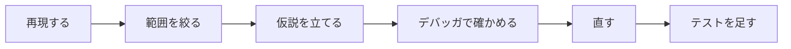

# デバッガで流れを追う

第4回（制御構造）の演習の前に

<div class="opacity-70 mt-8">

Visual Studio のブレークポイント・ステップオーバー・ローカル変数の表示

</div>

<!--
所要時間の目安: 5〜7 分。
講義の「7　二重ループとテスト」でブレークポイントとステップオーバーを扱った回に使う。
画面の表記は Visual Studio 2026（英語版）で，日本語版の名前を括弧で添えている。
-->

---

# 今日できるようになること

<v-clicks>

1. 調べたい行で**プログラムを止める**（ブレークポイント）
2. **1 文ずつ**進めて，どの行が実行されたかを見る（ステップオーバー）
3. その時点の**変数の値**を見る（**Locals** ウィンドウ）

</v-clicks>

<div v-click class="mt-10 p-4 border rounded">

紙に書いた「値の追跡表」を，デバッガで**答え合わせ**できるようになる

</div>

<!--
演習の課題には「値を追跡する」表がある。紙で予測してからデバッガで確かめる，という順番を勧める。
-->

---

# printf を足す前に

| | `printf` を足して実行 | デバッガで止める |
| --- | --- | --- |
| 見られるもの | 書いた式の値だけ | その時点の**すべての**変数 |
| 見る場所を変えるとき | 書き直してビルドし直す | ブレークポイントを動かすだけ |
| 「どの行を通ったか」 | 分かりにくい | 黄色の矢印で分かる |
| 後始末 | 消し忘れると出力が変わる | 何も残らない |

<div v-click class="mt-6">

`printf` が悪いわけではない。**「どこで・何が」違うかを探すときは，まずデバッガ**。

</div>

---

# 例: 3 の倍数の合計

```c {all|7|8-12|13}
#include <stdio.h>

int main(void)
{
    int n = 9;
    int sum = 0;
    // 1 から n までの 3 の倍数の合計（n = 9 なら 3 + 6 + 9 = 18 のはず）
    for (int i = 1; i < n; ++i) {
        if (i % 3 == 0) {
            sum += i;
        }
    }
    printf("%d\n", sum);
    return 0;
}
```

<div v-click class="mt-4">

**期待**: `18` ／ **実際**（Ctrl+F5）: `9` → どこかが違う

</div>

<!--
演習の課題そのものではなく，同じ形の別のプログラムを使う（課題の答えを見せないため）。
誤りは 8 行目の条件 i < n（正しくは i <= n）。ここでは答えを言わない。
-->

---

# 探し方の型



<v-clicks>

- **再現する**: 同じ入力で，毎回同じ違いが出るか（`n = 9` で `9` が出る）
- **範囲を絞る**: どこまでは正しいか（`sum` に何が足されたか）
- **仮説を立てる**: 「9 が足されていないのでは？」
- **確かめる**: 止めて，変数の値を見る ← **今日はここ**

</v-clicks>

---

# ① 止めたい行にブレークポイント

```c {9}
#include <stdio.h>

int main(void)
{
    int n = 9;
    int sum = 0;
    // 1 から n までの 3 の倍数の合計（n = 9 なら 3 + 6 + 9 = 18 のはず）
    for (int i = 1; i < n; ++i) {
        if (i % 3 == 0) {
            sum += i;
        }
    }
    printf("%d\n", sum);
    return 0;
}
```

- `if` の行をクリックして **F9**（**Debug > Toggle Breakpoint**／ブレークポイントの設定/解除）
- 行番号の左に**赤い丸**が付く（左の余白をクリックしても同じ）

---

# ② F5 で開始する（Ctrl+F5 ではない）

| キー | メニュー（英語版） | 日本語版 | ブレークポイントで |
| --- | --- | --- | --- |
| **F5** | **Debug > Start Debugging** | デバッグの開始 | **止まる** |
| Ctrl+F5 | **Debug > Start Without Debugging** | デバッグなしで開始 | 止まらない |

<div v-click class="mt-8">

止まると，次に実行する行に**黄色の矢印**が出る。

まだその行は**実行されていない**ことに注意。

</div>

<!--
「止まらない」という質問のほとんどは Ctrl+F5 で起動している。
-->

---

# ③ Locals で変数を見る

**Debug > Windows > Locals**（ローカル）

| 名前 | 1 回目に止まったとき | 2 回目 | 3 回目 |
| --- | --- | --- | --- |
| `n` | 9 | 9 | 9 |
| `i` | 1 | 2 | 3 |
| `sum` | 0 | 0 | 0 |

<v-clicks>

- F5（**Debug > Continue**／続行）を押すと，次にブレークポイントの行に来たところで止まる
- 変わった値は**赤く**表示される
- 止まった行の `sum` は「**加算する前**」の値

</v-clicks>

---

# ④ F10 で 1 文ずつ進める

```c {9|10|8|9|8|9|8|9|10|8}
#include <stdio.h>

int main(void)
{
    int n = 9;
    int sum = 0;
    // 1 から n までの 3 の倍数の合計（n = 9 なら 3 + 6 + 9 = 18 のはず）
    for (int i = 1; i < n; ++i) {
        if (i % 3 == 0) {
            sum += i;
        }
    }
    printf("%d\n", sum);
    return 0;
}
```

**F10**（**Debug > Step Over**／ステップ オーバー）: 黄色の矢印が 1 文ずつ進む

<div v-click>

`i` が 3 の倍数のときだけ 10 行目を通る。本体の最後まで進むと **`for` の行に戻り**，`++i` と条件判定をする。

</div>

---

# ⑤ 最後の反復を見る

| `i` | 条件 `i < n` | `if` は真？ | `sum`（加算後） |
| --- | --- | --- | --- |
| 3 | 真 | 真 | 3 |
| 6 | 真 | 真 | 9 |
| 8 | 真 | 偽 | 9 |
| <span v-mark.red="1">9</span> | <span v-mark.red="1">**偽**</span> | — | — |

<div v-click="2" class="mt-6">

`i` が 9 のとき，条件 `i < n` が偽になって**本体に入らない** → 9 が足されない

→ 仮説どおり。直し方: `i <= n`

</div>

<!--
条件付きブレークポイント（i == 9 のときだけ止める）を見せてもよい（授業では未習）。
ブレークポイントを右クリック → Conditions → Conditional Expression の Is true に i == 9。
-->

---

# ⑥ 直したら，境界の値で確かめる

| `n` | 本体を実行する回数 | 期待する出力 |
| --- | --- | --- |
| 0 | 0 回 | `0` |
| 1 | 1 回 | `0` |
| 3 | 3 回（3 がちょうど最後） | `3` |
| 9 | 9 回 | `18` |

<div v-click class="mt-6">

繰り返しは **0 回・1 回・複数回**と，**最後の値がちょうど対象になる場合**を試す（講義 7 節）。

1 つの値で合っても，境界で間違っていることがある。

</div>

---

# よくあるつまずき

<v-clicks>

- **止まらない** → Ctrl+F5 で起動している／その行が実行されない（`n = 0` など）／ビルドに失敗して古い実行ファイルが動いている（**Error List** を見る）
- **変な数が見える**（`-858993460` など）→ まだ代入される前の変数。値に意味はない
- **止まらなくなった**（無限ループ）→ **Debug > Break All** で一時停止すると，繰り返している行と変数が見える
- **やめたい** → **Debug > Stop Debugging**（デバッグの停止，Shift+F5）

</v-clicks>

---

# キーの早見表

| キー | 英語版 | 日本語版 | この授業で |
| --- | --- | --- | --- |
| F9 | **Toggle Breakpoint** | ブレークポイントの設定/解除 | 第4回 |
| F5 | **Start Debugging** / **Continue** | デバッグの開始／続行 | 第4回 |
| F10 | **Step Over** | ステップ オーバー | 第4回 |
| Shift+F5 | **Stop Debugging** | デバッグの停止 | 第4回 |
| F11 | **Step Into** | ステップ イン | 関数・ポインタの回で |
| Shift+F11 | **Step Out** | ステップ アウト | 関数・ポインタの回で |

<div class="mt-4 opacity-70 text-sm">

メニューはどれも **Debug** の下。VS Code では **Run and Debug** ビューで同じキーが使える。

</div>

---
layout: center
---

# まとめ

1. 調べたい行で **F9**，**F5** で開始
2. **Locals** で変数を見て，**F10** で 1 文ずつ
3. 予測（紙の表）と違ったところが，誤りの近く

<div class="mt-10 p-4 border rounded">

課題の「値を追跡する」表を，デバッガで答え合わせしてみましょう

</div>

<!--
早く終えた学生には，デバッグの題材（debugging/ の第4回の題材）を渡して練習させる。
題材の README は答えを含むので，学生にはソースだけを渡す。
-->
