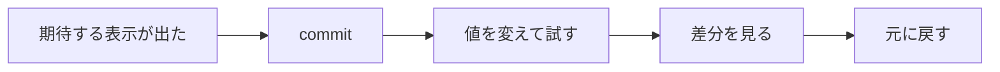

# 動いたら commit， 試したら差分

Visual Studio の Git で，試す前の状態に 1 回の操作で戻る（授業では未習）

関係する回: 第2回〜（値を変えて試す課題のある回。第9回の実験の前にも）

Git を使わないなら，変える前の行をコメント（`//`）にして残し，試した後に戻す

<!--
使う場面: 「値を変えて試す → 元に戻す」小問のある課題を終えた学生（第2回〜）。戻し忘れ・戻し間違いをした学生。第9回のように 1 か所を変えて違いを見る実験の前。
- 1 回に全部見せない。初めての学生には「最初に 1 回」と「commit する」まで（約 3 分）。次に声をかけたときに「差分を見て戻す」（約 2 分）。
- Git は授業では扱っていない。使うかどうかは学生に任せ，使わない学生には「変える前の行をコメントにして残す」方法でもよいと伝える。
- 画面の表記は Visual Studio 2026（英語版）。日本語版の名前を括弧で添えている（実務の手引きの対応表と同じ）。
- 問「値を変えて試した後，元に戻ったことはどうやって確かめた？」→ 答えられなければこのスライドの出番。
- よくある反応「Git は授業で習っていない」→ 使わなくてよい。表紙のとおりコメントで残す方法でもよい。
- 詳しくは実務の手引きの第2回・第9回の節と「Git の最小の手順」。
-->

---

# なぜ commit するのか

- 手で戻すと，**戻し忘れ・戻し間違い**が起きる（提出したら 1 文字違っていた，など）
- commit すると，その時点の内容が**履歴に残る**。後で比べる・戻すが 1 回の操作でできる
- 保存（Ctrl+S）はファイルを上書きするだけで，前の内容は残らない

<!--
使う場面: commit を勧める最初の 1 枚。
- 問「commit は保存（Ctrl+S）と何が違う？」→ 保存はファイルを今の内容で上書きするだけ。commit はその時点の内容を履歴に残すので，後から比べたり戻したりできる。
- よくある反応「GitHub に上げないといけない？」→ 上げなくてよい（次のスライド）。履歴は自分の PC の中だけに残る。
-->

---

# 最初に 1 回だけ

1. **Git > Settings**（Git > 設定）の **Git Global Config**（Git グローバル構成）で **User name**・**Email** を確かめる（未設定なら入力。公開しないので自分が分かる値でよい）
2. 課題のソリューションを開いたまま **Git > Create Git Repository**（Git リポジトリの作成）
3. **Other**（その他）で **Local**（ローカル）を選び，**Local path** を作業場所のフォルダ（例: `PL1`）にして **Create**（作成）

- **Local** ならどこにもアップロードされない。課題の解答を公開の場所に置かない
- 作業場所のフォルダ全体が 1 つのリポジトリになる。ほかの課題の `.sln` を開いても同じものが使われる

<!--
使う場面: Git を初めて使う学生（約 2 分）。
- Microsoft Learn の本文には Create and Push とあるが，Local を選んだ画面のボタンは Create。VS 2022 では選択肢の名前が Local only（ボタンは同じ Create）。
- Git Global Config の項目名，Local only と Create の対応，Local path に親のフォルダ（PL1）を選べることは，VS 2026 の画面で一度確かめておく。
- .gitignore template は Visual Studio 用のままでよい。x64 や .vs などのビルドの生成物は履歴に入らない。
- 問「この履歴はどこにある？」→ 作業場所のフォルダの中の .git フォルダ。自分の PC の中だけ。
- よくある反応「Create が押せない」→ Local path が空か，そのフォルダに既にリポジトリがある。
- よくある反応「GitHub のサインインが出た」→ Other の Local を選び直す（GitHub などへ push する選択肢を選んでいる）。
-->

---

# commit する

1. 期待する表示が出たら，**View > Git Changes**（表示 > Git の変更）を開く
2. 変更したファイルの一覧を見て，メッセージを 1 行書く
3. **Commit All**（すべてコミット）

| メッセージの例 | |
| --- | --- |
| `week02 Rectangle: 期待する 3 行を確認` | 何をしたかが後で分かる |
| `fix` | 何を直したか分からない |

commit は **1 つの意味のある変更ごと**。3 つの課題の変更を 1 回にまとめない

<!--
使う場面: リポジトリを作った直後，または課題の期待する表示が出たところ。
- 問「1 回の commit に 3 つの課題の変更をまとめると何が困る？」→ 1 つだけ戻したいときに戻せず，差分も読みにくい。
- よくある反応「Git Changes に何も出ない」→ 保存していない，または開いたフォルダがリポジトリの外。x64 や .vs が出ないのは .gitignore で除外しているためで正常。
-->

---

# 差分を見て，元に戻す

**Git Changes** のファイルをダブルクリック → 左が前回の commit，右が今のファイル

| 左（前回の commit） | 右（今のファイル） |
| --- | --- |
| `int limit = 10;` | `int limit = 0;`（変えた行に色が付く） |

- 戻すときは，ファイルを右クリック → **Undo Changes**（変更を元に戻す）。commit していない変更は消える
- 戻したら**ビルドし直す**（ソースは戻っても，`exe` は前のビルドのまま）

<!--
使う場面: 値を変えて試した後（約 2 分）。
- 問「Undo Changes の後，exe も元に戻っている？」→ 戻っていない。戻るのはソースだけなので，ビルドし直して元の表示が出ることを確かめる。
- 例の差分は説明用（課題のコードではない）。学生の課題では，自分が変えた 1 行が差分に出ることを見せる。
- VS Code では Source Control ビュー（Ctrl+Shift+G）で同じことができる。
- よくある反応「Undo Changes が見つからない」→ Git Changes の一覧のファイル名を右クリックする（エディタの中ではない）。
- よくある反応「戻したのに表示が変わらない」→ ビルドし直していない（古い exe を実行している）。
-->

---

# 実験の前に commit，commit の前に差分

- 1 か所を変えて違いを見る実験の**前に** commit する。戻すときに「どこを変えたっけ」と探さずに済む
- commit の**前に**差分を読み，変えた覚えのない行が混ざっていないか確かめる
- 履歴は **Git > View Branch History**（Git > ブランチ履歴の表示）。commit を選ぶと，そのときの変更が見える

| 操作 | すること |
| --- | --- |
| **Undo Changes** | まだ commit していない変更を捨てる |
| **Revert**（元に戻す） | **Git > View Branch History** で commit を右クリック → **Revert**。その commit を打ち消す commit を新しく作る（履歴は残る） |

<!--
使う場面: 第9回のように，1 か所を変えて結果を比べる実験が続く回。commit を忘れて実験してしまった学生。
- 問「差分に，自分が変えた覚えのない行が出ていたらどうする？」→ commit する前にその行を確かめる。誤って消した行や貼り付けた行を見つける機会になる。
- よくある反応「commit を忘れて実験してしまった」→ ファイルを閉じていなければ Ctrl+Z で戻せる。どこを変えたか分からないときは Undo Changes で前回の commit の状態に戻す（commit 後の変更はすべて消える）。
- 日本語版では Undo Changes も Revert も「元に戻す」に近い名前になるので，英語の名前で区別する。
-->
